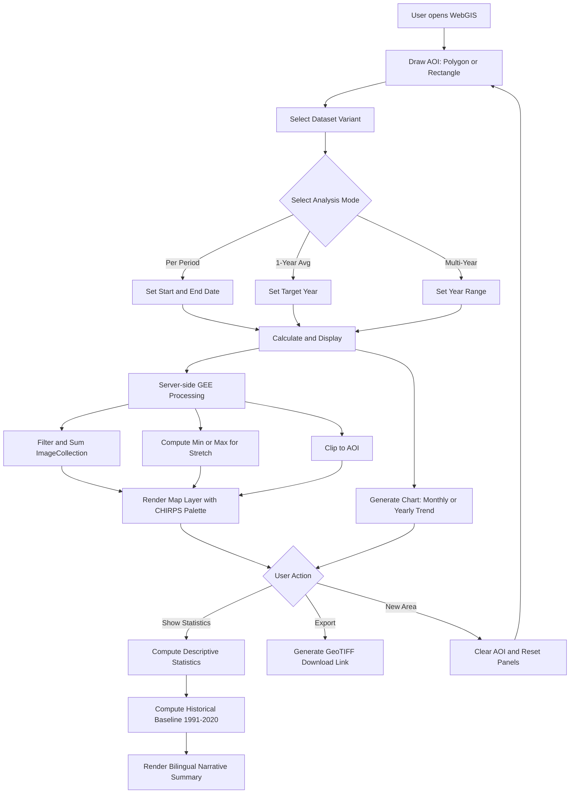

EE CHIRPS RainMapper is a lightweight, browser-based WebGIS tool built entirely inside the Google Earth Engine (GEE) Code Editor. It lets users draw or upload an Area of Interest (AOI) and instantly analyze rainfall accumulation and trends using the CHIRPS

[Repositori di GitHub](https://github.com/Defani/EE-CHIRPS-RainMapper--GEE-APPS)

A no-code Google Earth Engine App for exploring, analyzing, and downloading CHIRPS precipitation data through an interactive WebGIS interface.

**Live App:** https://defaniarman.users.earthengine.app/view/ee-chirps-rainmapper

**Author:** Defani Arman Alfitriansyah
**Affiliation:** Faculty of Forestry and Environment, Universitas Kuningan

---

## Overview

EE CHIRPS RainMapper is a Google Earth Engine (GEE) App built entirely with the `ui` module, designed to remove the friction of manually processing CHIRPS rainfall data (clipping to a region, summing over time, computing annual averages, and generating trend charts). All processing is handled server-side on GEE and delivered through a browser interface, without requiring the user to write or modify any code.

The app supports drawing a custom Area of Interest (AOI), selecting between CHIRPS Daily or Pentad datasets, running one of three analysis modes, and exporting results as GeoTIFF or chart-derived CSV. The interface is fully bilingual (English/Indonesian) and includes an automatically generated narrative summary comparing the selected period against a historical baseline.

---

## Features

- **Custom AOI drawing** — polygon or rectangle, drawn directly on the map, with a clear/reset option
- **Dataset selection** — CHIRPS Daily (~5 km, 1981–present) or CHIRPS Pentad (~5 km, 1981–present)
- **Three analysis modes:**
  - *Per Period* — total precipitation over a user-defined date range
  - *1-Year Average* — annual total plus a monthly precipitation trend chart
  - *Multi-Year* — multi-year average plus an interannual trend chart with linear trendline
- **Dynamic min/max stretching** computed per AOI, using the official CHIRPS visualization palette
- **Descriptive statistics** — mean, median, standard deviation, minimum, maximum, and AOI area, computed via `ee.Reducer` combinations
- **Automatic narrative summary** — compares the selected period's mean rainfall against a 1991–2020 historical baseline, generated in both English and Indonesian
- **Data export** — GeoTIFF download via `getDownloadURL()`, and chart data exportable as CSV/SVG/PNG through the built-in Google Charts menu
- **Bilingual interface** — toggle between English and Indonesian without reloading the page, driven by a single translation dictionary
- **Dark basemap with light UI panels** — custom Google Maps JSON style applied only to the basemap layer

---

## System Workflow

---

## Interface Layout

```mermaid
flowchart LR
    subgraph LeftPanel [Left Panel]
        L1[AOI Tools]
        L2[Dataset Selector]
        L3[Analysis Mode Tabs]
        L4[Date or Year Inputs]
        L5[Calculate Button]
        L6[Export and Stats Buttons]
    end

    subgraph MapPanel [Map Panel]
        M1[Dark Basemap]
        M2[Rendered Precipitation Layer]
        M3[Drawing Tools Overlay]
    end

    subgraph RightPanel [Right Panel]
        R1[Legend]
        R2[Trend Chart]
        R3[Descriptive Statistics Table]
        R4[Narrative Summary]
        R5[Dataset References]
    end

    LeftPanel --> MapPanel
    MapPanel --> RightPanel
```

---

## Technical Notes

- Built using the GEE `ui` API (`ui.Map`, `ui.Panel`, `ui.Chart`, `ui.DateSlider`) — no external frontend framework
- Rainfall accumulation computed with `ImageCollection.sum()` over the filtered date range, per mode
- Min/max values for map stretching are computed per AOI via `reduceRegion()` with `ee.Reducer.minMax()` rather than using fixed values, so the color scale adapts to each region and period
- Descriptive statistics computed with a combined reducer chain (`mean`, `median`, `stdDev`, `min`, `max`)
- Historical baseline fixed at 1991–2020 (or capped at `current year − 1` if that range is unavailable), following the WMO convention for 30-year climate normals
- All UI text is centralized in a single translation dictionary (`T.en` / `T.id`) referenced through a `tr(key)` helper, allowing the interface to switch language without a page reload

---

## Dataset Reference

1. Funk, C., Peterson, P., Landsfeld, M., Pedreros, D., Verdin, J., Shukla, S., Husak, G., Rowland, J., Harrison, L., Hoell, A., & Michaelsen, J. (2015). The climate hazards infrared precipitation with stations — a new environmental record for monitoring extremes. *Scientific Data*, 2, 150066. https://doi.org/10.1038/sdata.2015.66

2. UC Santa Barbara Climate Hazards Center. (n.d.). *CHIRPS: Climate Hazards Center InfraRed Precipitation with Station data.* https://www.chc.ucsb.edu/data/chirps

3. Google Earth Engine Data Catalog. *UCSB-CHG/CHIRPS/DAILY: Climate Hazards Group InfraRed Precipitation with Station Data (CHIRPS).* https://developers.google.com/earth-engine/datasets/catalog/UCSB-CHG_CHIRPS_DAILY

4. Google Earth Engine. *UI Widgets Guide.* https://developers.google.com/earth-engine/guides/ui_widgets

---

## Links

- Live App: https://defaniarman.users.earthengine.app/view/ee-chirps-rainmapper
- CHIRPS Data Portal: https://www.chc.ucsb.edu/data/chirps
- GEE Dataset Catalog Entry: https://developers.google.com/earth-engine/datasets/catalog/UCSB-CHG_CHIRPS_DAILY
