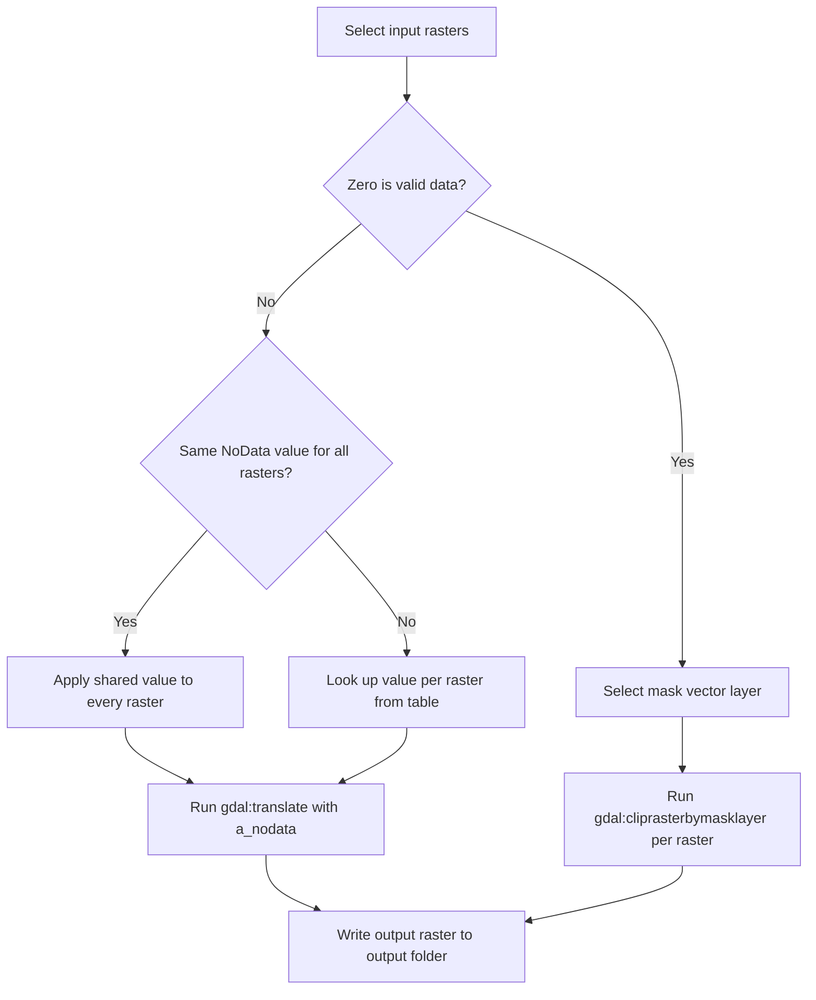

QGIS Processing script to remove black/fixed-value background from rasters clipped by shapefile in Google Earth Engine

[Repositori di GitHub](https://github.com/Defani/qgis-remove-black-background)

QGIS Processing Toolbox script to remove the black (or otherwise fixed-value) background left around imagery clipped by a shapefile in Google Earth Engine.

When you clip an image in GEE using `.clip(shp)`, pixels outside the boundary are masked but often exported as a fixed value (usually `0`) instead of proper NoData. This shows up as a black background around the study area in QGIS. This script fixes that for one or many rasters in a single run, in either of two modes.

Author: Defani Arman Alfitriansyah

## Modes

**Value-based NoData (default)**
Assumes the background value is not valid data anywhere in the raster, and assigns it as NoData using `gdal:translate`. This value can be the same for every input raster, or different per raster, useful when rasters belong to different categories and `0` is background in some but a real class value in others.

**Zero is valid data**
Use this when the background value is a legitimate data value in one or more rasters, for example NDVI or LST. Instead of flagging pixels by value, each raster is clipped directly against a mask vector layer using `gdal:cliprasterbymasklayer`, so the area outside the boundary becomes NoData regardless of pixel value. The same mask is applied to all selected rasters.

## Decision flow

## Installation

1. Open QGIS
2. Processing Toolbox panel, click the Python icon, Add Script to Toolbox
3. Select `remove_black_background.py`
4. The tool appears under the group "Defani Arman Alfitriansyah Tools" as "Remove Black Background (GEE Clip, Batch)"

## Parameters

| Parameter | Description |
|---|---|
| Input rasters | One or more rasters to process |
| Zero is valid data | Permanent checkbox, switches between value-based NoData and mask-based clip |
| Same NoData value for all rasters | Permanent checkbox, used when the mode above is off |
| Shared background value | Used when the value is the same for all rasters, default `0` |
| Per-raster NoData values | Table of layer name and NoData value, used when values differ per raster |
| Mask vector layer | Polygon layer used to clip when zero is valid data |
| Output folder | Destination folder, one output file per input raster named `<layer_name>_nodata.tif` |

## Notes

- If a background value is a legitimate value in some rasters, use the mask-based mode for those, or run the value-based mode with per-raster values for the rest.
- The mask layer should match the boundary used in the original Google Earth Engine clip for consistent results.
- Fixing the issue at the source in Google Earth Engine, by using `updateMask()` instead of `clip()` before export, avoids the problem entirely and this script becomes optional.
